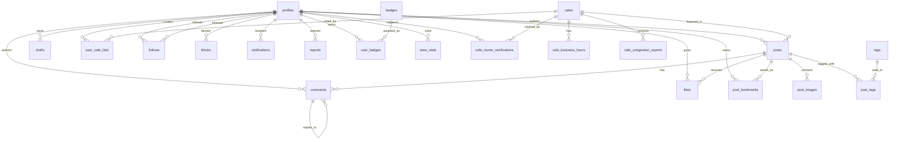

# データモデル概要

Supabase (PostgreSQL) を前提としたデータモデル設計です。詳細なカラム定義は [tables.md](./tables.md) を参照してください。

## 設計方針

1. **認証はSupabase Authに委譲**し、`public.profiles` テーブルで追加プロフィールを持つ。
2. **認可はRLS (Row Level Security)** を全テーブルで有効化し、Supabase側で保護する。
3. **論理削除を基本**（`deleted_at`）にし、通報・監査のために履歴を残す。
4. **カウンタ系（いいね数、コメント数等）はデノーマライズ**し、トリガーで維持。
5. **地理情報はPostGIS**（`geography(POINT, 4326)`）を利用。
6. **全文検索はPostgres FTS**（`tsvector` + GINインデックス）。日本語形態素解析には `pgroonga` の導入を検討（Supabase有効化可能）。
7. **年齢確認は登録フローで実施**し、`profiles.birth_date` を必須項目とする。
8. **拡張性のためのカラム余地** — `metadata jsonb` を主要テーブルに配置し、後回し機能（社会的証明カウンタ等）を追加できるようにする。

## エンティティ分類

| 分類 | テーブル |
|---|---|
| ユーザー | `profiles`, `follows`, `blocks` |
| カフェ | `cafes`, `cafe_business_hours`, `cafe_congestion_reports`, `cafe_owner_verifications` |
| コンテンツ | `posts`, `post_images`, `drafts`, `comments` |
| タグ | `tags`, `post_tags` |
| インタラクション | `likes`, `user_cafe_lists`, `post_bookmarks` |
| モデレーション | `reports`, `ng_words`, `audit_logs` |
| 通知 | `notifications` |
| ゲーミフィケーション | `badges`, `user_badges`, `area_visits` |

## ER図（概観）



## 「お気に入り」「行きたい」「保存」の設計判断

3種類の保存機能を以下のように分離しました:

| 種別 | 対象 | テーブル | 意味 |
|---|---|---|---|
| お気に入り | カフェ | `user_cafe_lists` (type='favorite') | 常連・好きなカフェ |
| 行きたい | カフェ | `user_cafe_lists` (type='want_to_go') | まだ行っていない候補 |
| 保存 | 投稿 | `post_bookmarks` | 参考にしたい投稿 |

カフェ2種は同一テーブルに `list_type` enum で統一。将来「行った」「マイリスト」等の追加も柔軟。

## 年齢確認 / 未成年保護の設計

- `profiles.birth_date` を **必須**（NULL不可）
- 生成カラム `age` はSQL関数で算出
- 13歳未満はサインアップ時にブロック（アプリ層 + DBトリガー両方でガード）
- 13〜17歳は `guardian_consent_at` が NULL の間はアカウント無効化状態（`status = 'pending_consent'`）
- 保護者同意は別途 `guardian_email` に送信されるメールで完了

## 下書き自動保存の設計

- `drafts` テーブルにJSONBで途中状態を保持
- `(author_id, client_draft_key)` で端末別下書きを管理
- `expires_at` で30日後自動削除（cron or scheduled function）
- クライアントは変更検知で15秒デバウンス保存

## バッジ付与ロジックの設計

バッジ付与は **Server Actions から呼ぶ `checkAndAwardBadges` 関数で一元処理** する。DBトリガーに分散させない。

### 判断理由

- 付与条件（`badges.criteria jsonb`）が複雑になるほどPLPGSQLは可読性・テストコストが上がる
- TypeScript で記述すれば Vitest でユニットテスト可能
- 付与ロジックを追加・変更しても、マイグレーションではなくアプリコード変更で済む

### 呼び出し方針

```
// トリガーごとに呼び出し元が異なる
app/_actions/posts.ts  → checkAndAwardBadges(userId, 'POST_CREATED')
app/_actions/likes.ts  → checkAndAwardBadges(userId, 'LIKE_RECEIVED')
app/_actions/owner.ts  → checkAndAwardBadges(userId, 'REGULAR_AWARDED')
// など
```

`checkAndAwardBadges` は `lib/badges/check.ts` に配置し、`trigger` の種別に応じて対象バッジを絞って判定する（全バッジを毎回評価しない）。付与済みバッジは `user_badges` にUPSERTして重複しない。

### 実装例（概略）

`BadgeTrigger` 型は `types/badges.ts` に定義する。

```typescript
// lib/badges/check.ts
export async function checkAndAwardBadges(
  supabase: SupabaseClient,
  userId: string,
  trigger: BadgeTrigger,  // 'POST_CREATED' | 'LIKE_RECEIVED' | ...
): Promise<void> {
  const candidates = BADGE_RULES.filter(r => r.triggers.includes(trigger))
  // check() は独立しているので並列実行してよい
  const results = await Promise.all(candidates.map(r => r.check(supabase, userId)))
  for (const [rule, earned] of candidates.map((r, i) => [r, results[i]] as const)) {
    if (earned) {
      await supabase.from('user_badges').upsert(
        { user_id: userId, badge_id: rule.id },
        { onConflict: 'user_id,badge_id' },
      )
      await supabase.from('notifications').insert({
        recipient_id: userId, type: 'badge', entity_type: 'badge',
        entity_id: rule.id, payload: {},
      })
    }
  }
}
```

**注意 — `'REGULAR_AWARDED'` トリガーについて:**
`owner.ts` は常連認定時に `notifications.type = 'regular_awarded'` を送信する（[tables.md regular_customers 参照](./tables.md#regular_customers)）。
`checkAndAwardBadges(userId, 'REGULAR_AWARDED')` はバッジ付与（`type: 'badge'`）のみを担当する。
`'regular_awarded'` 通知と `'badge'` 通知は別物であり、二重送信ではない。

バッジ定義は `lib/badges/rules.ts` に集約し、`badges.criteria` の中身と対応させる。

---

## モデレーション設計

- `reports.status` で通報のワークフロー管理（pending / reviewing / resolved / rejected）
- `ng_words` は投稿・コメント時に事前チェック
- `blocks` は投稿・コメントの表示フィルタに反映（RLSポリシーで自動除外）
- `audit_logs` に運営操作を記録

## RLSポリシー方針（概要）

| テーブル | SELECT | INSERT | UPDATE | DELETE |
|---|---|---|---|---|
| profiles | 全公開（プライベート項目は除外View） | 認証済みユーザー本人 | 本人のみ | 不可（無効化のみ） |
| posts | 公開状態のみ / ブロック相手を除外 | 認証済みユーザー本人 | 作者のみ | 作者のみ（論理削除） |
| comments | 同上 | 認証済み | 作者のみ | 作者・投稿主 |
| likes / bookmarks | 本人のみ | 本人 | 不可 | 本人 |
| reports | 本人 + admin | 認証済み | admin | 不可 |
| cafes | 全公開 | 認証済み | 認証済み owner or admin | admin |

詳細は tables.md の各テーブル節を参照。

## エリアコードの一貫性

制覇マップ機能の実現には、投稿対象カフェとエリア訪問実績の紐付けが必要。以下のルールで整合を保つ:

- `cafes.area_code` と `area_visits.area_code` は同一のコード体系（例: `JP-13-shibuya`）
- 投稿INSERT時のトリガー例:
  ```
  INSERT INTO area_visits (user_id, area_code, ...)
  SELECT NEW.author_id, c.area_code, NEW.published_at
  FROM cafes c WHERE c.id = NEW.cafe_id AND c.area_code IS NOT NULL
  ON CONFLICT (user_id, area_code) DO UPDATE
    SET visit_count = area_visits.visit_count + 1,
        last_visited_at = NEW.published_at;
  ```
- `cafes.area_label` はUI表示専用（検索フィルタでは code 側を使う）
- コード体系の詳細と初期セットは [seed/areas-initial-set.md](../../seed/areas-initial-set.md) 参照

## インデックス方針（主要）

- `posts (author_id, created_at DESC)` — プロフィール投稿一覧
- `posts (cafe_id, created_at DESC)` — カフェ別投稿一覧
- `posts USING GIN(body_search)` — 全文検索
- `cafes USING GIST(location)` — 地理検索
- `post_tags (tag_id)` / `(post_id)` — タグ検索
- `follows (follower_id)` / `(followee_id)` — タイムライン
- `notifications (recipient_id, created_at DESC) WHERE read_at IS NULL` — 未読通知
