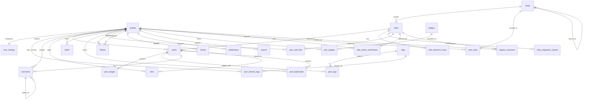

# データモデル概要

Supabase (PostgreSQL) を前提としたデータモデル設計です。詳細なカラム定義は [tables.md](./tables.md) を参照してください。

## 設計方針

1. **認証はSupabase Authに委譲**し、`public.profiles` テーブルで追加プロフィールを持つ。
2. **認可はRLS (Row Level Security)** を全テーブルで有効化し、Supabase側で保護する。
3. **論理削除を基本**（`deleted_at`）にし、通報・監査のために履歴を残す。
4. **カウンタ系（いいね数、コメント数等）はデノーマライズ**し、トリガーで維持。
5. **地理情報はPostGIS**（`geography(POINT, 4326)`）を利用。
6. **全文検索は `simple` tsvector + `pg_trgm` の2本立て**（決定 2026-09-05）。日本語の部分一致は pg_trgm が担う。PGroonga は導入せず、精度が課題化したら索引を張り替えて移行する（[tables.md #全文検索の方式](./tables.md#全文検索の方式決定-2026-09-05)）。
7. **年齢確認は登録フローで実施**し、`profiles.birth_date` を必須項目とする。
8. **拡張性のためのカラム余地** — `metadata jsonb` を主要テーブルに配置し、後回し機能（社会的証明カウンタ等）を追加できるようにする。

## エンティティ分類

| 分類 | テーブル |
|---|---|
| ユーザー | `profiles`, `user_settings`, `user_interest_tags`, `follows`, `blocks` |
| エリア | `areas` |
| カフェ | `cafes`, `cafe_business_hours`, `cafe_congestion_reports`, `cafe_owner_verifications` |
| 幹C（オーナー連携） | `regular_customers` |
| コンテンツ | `posts`, `post_images`, `drafts`, `comments` |
| タグ | `tags`, `post_tags` |
| インタラクション | `likes`, `user_cafe_lists`, `post_bookmarks` |
| モデレーション | `reports`, `ng_words`, `audit_logs` |
| 通知 | `notifications` |
| ゲーミフィケーション | `badges`, `user_badges`, `area_visits` |

## ER図（概観）



## 「お気に入り」「行きたい」「保存」の設計判断

3種類の保存機能を以下のように分離しました:

| 種別 | 対象 | テーブル | 意味 |
|---|---|---|---|
| お気に入り | カフェ | `user_cafe_lists` (type='favorite') | 常連・好きなカフェ |
| 行きたい | カフェ | `user_cafe_lists` (type='want_to_go') | まだ行っていない候補 |
| 保存 | 投稿 | `post_bookmarks` | 参考にしたい投稿 |

カフェ2種は同一テーブルに `list_type` enum で統一。将来「行った」「マイリスト」等の追加も柔軟。

## 年齢確認 / 未成年保護の設計

- `profiles.birth_date` を **必須**（NULL不可）
- 生成カラム `age` はSQL関数で算出
- 13歳未満はサインアップ時にブロック（アプリ層 + DBトリガー両方でガード）
- 13〜17歳は `guardian_consent_at` が NULL の間はアカウント無効化状態（`status = 'pending_consent'`）
- 保護者同意は別途 `guardian_email` に送信されるメールで完了

## 下書き自動保存の設計

- `drafts` テーブルにJSONBで途中状態を保持
- `(author_id, client_draft_key)` で端末別下書きを管理
- `expires_at` で30日後自動削除（cron or scheduled function）
- クライアントは変更検知で15秒デバウンス保存
- `payload.image_paths` は「画像は選択時点で既にアップロード済み」を前提にしている。
  下記の予約行方式（[#ストレージ設計](#ストレージ設計)）と組み合わせるため、`payload` は
  予約済み `post_id` も持つ。再開時は同じ予約行を使い回し、二重予約と
  `image_paths` の postId 不一致を防ぐ（[pending-items D17](../../product/pending-items.md#d17-createpost-の-imagepaths-は画像アップロード時点で投稿行が既に存在することを前提にしている解消済み)、
  [tables.md #drafts](./tables.md#drafts)）

## バッジ付与ロジックの設計

バッジ付与は **Server Actions から呼ぶ `checkAndAwardBadges` 関数で一元処理** する。DBトリガーに分散させない。

### 判断理由

- 付与条件（`badges.criteria jsonb`）が複雑になるほどPLPGSQLは可読性・テストコストが上がる
- TypeScript で記述すれば Vitest でユニットテスト可能
- 付与ロジックを追加・変更しても、マイグレーションではなくアプリコード変更で済む

### 呼び出し方針

```
// トリガーごとに呼び出し元が異なる
app/_actions/posts.ts  → checkAndAwardBadges(userId, 'POST_CREATED')
app/_actions/likes.ts  → checkAndAwardBadges(userId, 'LIKE_RECEIVED')
app/_actions/owner.ts  → checkAndAwardBadges(userId, 'REGULAR_AWARDED')
// など
```

`checkAndAwardBadges` は `lib/badges/check.ts` に配置し、`trigger` の種別に応じて対象バッジを絞って判定する（全バッジを毎回評価しない）。付与済みバッジは `user_badges` にUPSERTして重複しない。

### 実装例（概略）

`BadgeTrigger` 型は `types/badges.ts` に定義する。

```typescript
// lib/badges/check.ts
export async function checkAndAwardBadges(
  supabase: SupabaseClient,
  userId: string,
  trigger: BadgeTrigger,  // 'POST_CREATED' | 'LIKE_RECEIVED' | ...
): Promise<void> {
  const candidates = BADGE_RULES.filter(r => r.triggers.includes(trigger))
  // check() は独立しているので並列実行してよい
  const results = await Promise.all(candidates.map(r => r.check(supabase, userId)))
  for (const [rule, earned] of candidates.map((r, i) => [r, results[i]] as const)) {
    if (earned) {
      await supabase.from('user_badges').upsert(
        { user_id: userId, badge_id: rule.id },
        { onConflict: 'user_id,badge_id' },
      )
      await supabase.from('notifications').insert({
        recipient_id: userId, type: 'badge', entity_type: 'badge',
        entity_id: rule.id, payload: {},
      })
    }
  }
}
```

**注意 — `'REGULAR_AWARDED'` トリガーについて:**
`owner.ts` は常連認定時に `notifications.type = 'regular_awarded'` を送信する（[tables.md regular_customers 参照](./tables.md#regular_customers)）。
`checkAndAwardBadges(userId, 'REGULAR_AWARDED')` はバッジ付与（`type: 'badge'`）のみを担当する。
`'regular_awarded'` 通知と `'badge'` 通知は別物であり、二重送信ではない。

バッジ定義は `lib/badges/rules.ts` に集約し、`badges.criteria` の中身と対応させる。

---

## ストレージ設計

**MVP は Supabase Storage に一本化する（決定 2026-09-05）。** 本格展開の段階で S3 + CloudFront へ移行する（[pending-items A5](../../product/pending-items.md)）。

### バケット構成

| バケット | 公開 | 参照元の列 | 内容 |
|---|---|---|---|
| `post-images` | public | [`post_images.storage_path`](./tables.md#post_images) | 投稿画像（最大10枚/投稿・10MB/枚） |
| `cafe-images` | public | [`cafes.main_image_path`](./tables.md#cafes) | カフェのメイン画像 |
| `avatars` | public | [`profiles.avatar_url`](./tables.md#profiles) | アバター（2MB） |
| `owner-documents` | **private** | [`cafe_owner_verifications.document_urls`](./tables.md#cafe_owner_verifications) | オーナー認証の提出書類 |

### オブジェクトパスの規約

```
post-images/{author_id}/{post_id}/{uuid}.webp
cafe-images/{cafe_id}/{uuid}.webp
avatars/{user_id}/{uuid}.webp
owner-documents/{user_id}/{verification_id}/{uuid}.{ext}
```

**先頭セグメントを所有者IDに固定する。** Supabase Storage のポリシーは `storage.foldername(name)[1] = auth.uid()::text` の形で書けるため、この規約がそのまま書き込み権限の担保になる。

### 権限

- **public バケット**は読み取り自由。書き込み・削除は上記パス規約で本人のみ
- **`owner-documents`** は読み取りも本人 + admin のみ。参照は都度発行する署名付きURL（有効期限は短く）
- `document_urls` には**公開URLではなくオブジェクトパスを保存する**（署名付きURLは期限切れするため、DBに焼き込まない）

### 投稿画像アップロードの前提（予約行方式）

`post-images` への署名付きアップロードURL発行（`createPostImageUploadUrl`）は
`is_post_author(postId)` で「実在する自分の投稿」を要求するため、composer で
「投稿する」ボタンを押す前に画像をプレビュー表示するには、その前に `posts` 行が
存在している必要がある。これを解決するため、composer 表示開始時（または最初の
画像選択時）に `reservePost` で空本文・`status='hidden'` の `posts` 行を予約作成し、
`createPost` はこの行を insert ではなく Postgres 関数 `finalize_post`（RPC、本文/タグ/画像確定 +
`status='published'` への更新を1トランザクションで行う）で確定させる
（[pending-items D17](../../product/pending-items.md#d17-createpost-の-imagepaths-は画像アップロード時点で投稿行が既に存在することを前提にしている解消済み)）。

予約したまま finalize されない hidden 投稿の掃除方針は未決
（[pending-items D19](../../product/pending-items.md#d19-reservepost-で予約した-hidden-投稿がfinalizeされないまま放置される問題)）。

### 移行を1箇所に閉じる

すべての読み書きは `lib/storage/` のラッパー経由にする。Server Actions やコンポーネントから Supabase Storage クライアントを直接呼ばない。S3 移行時の差し替え点をこのディレクトリだけに閉じるのが目的（[CLAUDE.md 開発哲学2](../../../CLAUDE.md)）。

### 無料枠の制約

Supabase Free の Storage は 1GB。投稿画像を 1枚 1MB に圧縮しても約1000枚で埋まる。**MVP検証には足りるが、公開後は容量監視が必須**。超えたら Pro（$25/月、100GB）へ上げるか S3 へ移行する。アップロード時の WebP 変換・リサイズは初期から入れる。

---

## モデレーション設計

- `reports.status` で通報のワークフロー管理（pending / reviewing / resolved / rejected）
- `ng_words` は投稿・コメント時に事前チェック
- `blocks` は投稿・コメントの表示フィルタに反映（RLSポリシーで自動除外）
- `audit_logs` に運営操作を記録

## RLSポリシー方針（概要）

| テーブル | SELECT | INSERT | UPDATE | DELETE |
|---|---|---|---|---|
| profiles | 全公開（プライベート項目は除外View） | 認証済みユーザー本人 | 本人のみ | 不可（無効化のみ） |
| posts | 公開状態のみ / ブロック相手を除外 | 認証済みユーザー本人 | 作者のみ | 作者のみ（論理削除） |
| comments | 同上 | 認証済み | 作者のみ | 作者・投稿主 |
| likes / bookmarks | 本人のみ | 本人 | 不可 | 本人 |
| reports | 本人 + admin | 認証済み | admin | 不可 |
| cafes | 全公開 | 認証済み + active | owner(active) or admin | admin |
| cafe_business_hours | 全公開 | owner(active) or admin | owner(active) or admin | owner(active) or admin |
| cafe_congestion_reports | 本人 + admin（集計は関数経由で全公開） | 認証済み本人 + active | 不可 | 不可 |

詳細は tables.md の各テーブル節を参照。

## エリアコードの一貫性

制覇マップ機能の実現には、投稿対象カフェとエリア訪問実績の紐付けが必要。以下のルールで整合を保つ:

- `cafes.area_code` と `area_visits.area_code` は同一のコード体系（例: `JP-13-shibuya-ku`）
- **副地域に投稿したら親の区も訪問済みにする** — カフェが `JP-13-omotesando`（`level='sub_area'`）に紐づく場合、`JP-13-shibuya-ku`（`level='ward'`）にも訪問を記録する。これをしないと「東京23区制覇」「3エリア訪問」系バッジが永久に達成できない
- 投稿の公開時にトリガーで自エリア + 親エリアの2行を upsert する:
  ```sql
  CREATE OR REPLACE FUNCTION public.record_area_visit() RETURNS trigger
  LANGUAGE plpgsql SECURITY DEFINER AS $$
  DECLARE
    visited_at timestamptz := coalesce(NEW.published_at, NEW.created_at, now());
  BEGIN
    INSERT INTO public.area_visits (user_id, area_code, first_visited_at, last_visited_at, visit_count)
    SELECT NEW.author_id, t.code, visited_at, visited_at, 1
    FROM public.cafes c
    JOIN public.areas a ON a.code = c.area_code
    CROSS JOIN LATERAL (VALUES (a.code), (a.parent_code)) AS t(code)
    WHERE c.id = NEW.cafe_id AND t.code IS NOT NULL
    ON CONFLICT (user_id, area_code) DO UPDATE
      SET visit_count     = area_visits.visit_count + 1,
          last_visited_at = GREATEST(area_visits.last_visited_at, EXCLUDED.last_visited_at);
    RETURN NULL;
  END $$;

  -- 「公開になった瞬間」だけ発火させる（下書き相当・非公開・論理削除は計上しない）
  CREATE TRIGGER posts_record_area_visit
  AFTER INSERT OR UPDATE OF status ON public.posts
  FOR EACH ROW
  WHEN (NEW.status = 'published' AND NEW.deleted_at IS NULL AND NEW.cafe_id IS NOT NULL)
  EXECUTE FUNCTION public.record_area_visit();
  ```
  - `published_at` は nullable でデフォルトを持たないため、そのまま `first_visited_at` / `last_visited_at`（ともに NOT NULL）へ入れると NOT NULL 違反になる。`coalesce` でフォールバックする
  - `area_visits` の RLS は「INSERT・UPDATE はシステム」なので、トリガー関数は `SECURITY DEFINER` で実行する
  - `AFTER UPDATE OF status` も対象にするのは、`archived` → `published` の復帰を取りこぼさないため。同一投稿の再公開で `visit_count` が二重に増えるのは許容する（訪問実績の粒度は「投稿回数」であり厳密な来店回数ではない）
- 「東京23区制覇」の母数は `areas.level = 'ward'` で数える（`parent_code IS NULL` だと吉祥寺のような23区外エリアが混入する）
- **エリアの表示名は `areas.label` を JOIN して取得する。`cafes` 側に表示名を複製しない**（コード体系の単一情報源を崩さないため）。検索フィルタも常に `areas.code` 側を使う
- コード体系の詳細と初期セットは [seed/areas-initial-set.md](../../seed/areas-initial-set.md) 参照

## インデックス方針（主要）

- `posts (author_id, created_at DESC)` — プロフィール投稿一覧
- `posts (cafe_id, created_at DESC)` — カフェ別投稿一覧
- `posts USING GIN(body_search)` — 英数字の語一致
- `posts USING GIN(body_text gin_trgm_ops)` — 日本語の部分一致（検索の主役）
- `user_interest_tags (tag_id, user_id)` — 「同じ気分の人」の逆引き
- `cafes USING GIST(location)` — 地理検索
- `post_tags (tag_id)` / `(post_id)` — タグ検索
- `follows (follower_id)` / `(followee_id)` — タイムライン
- `notifications (recipient_id, created_at DESC) WHERE read_at IS NULL` — 未読通知
