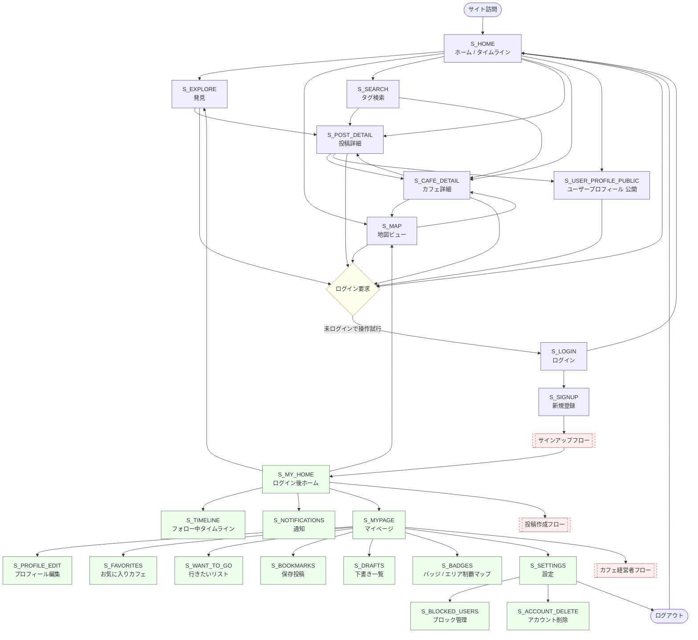
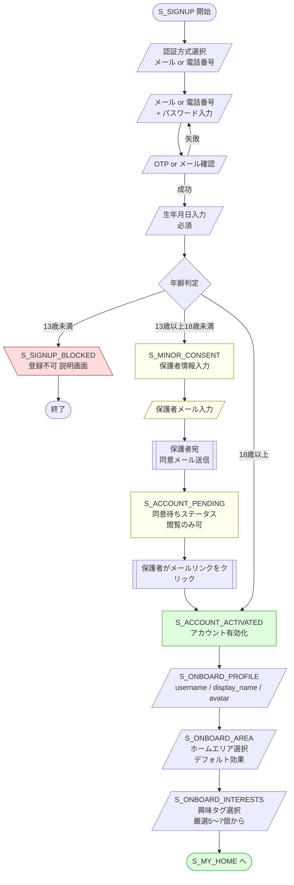
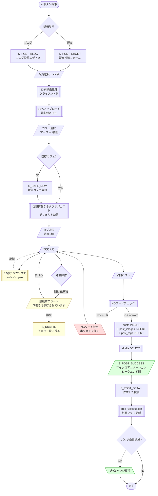
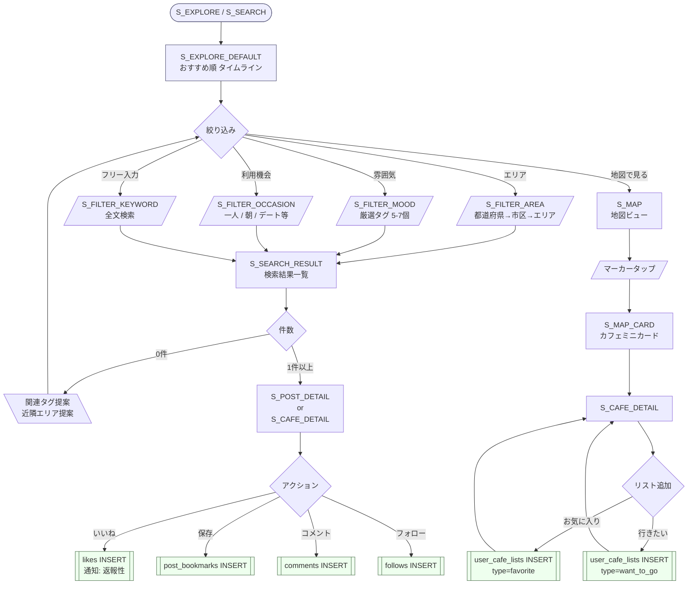
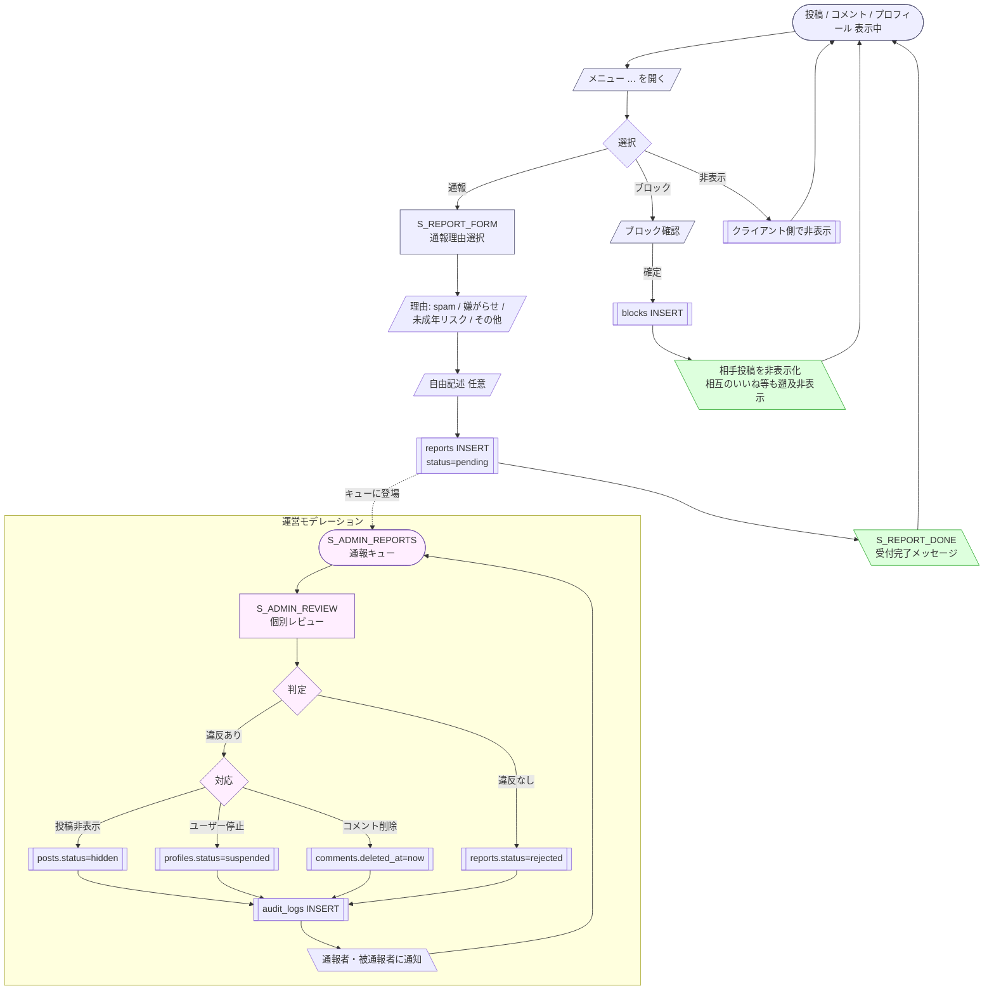
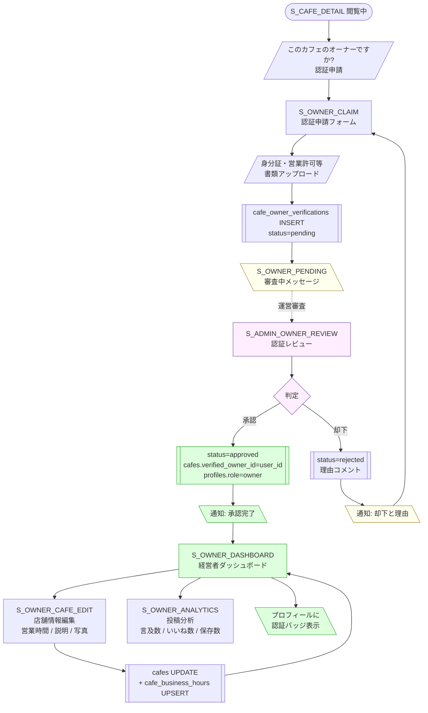

# 画面遷移図

MVPの主要画面と遷移をMermaid `flowchart` で示します。画面ID（例: `S_HOME`）はコード実装（ルート名やコンポーネント名）と対応させる想定です。

## 目次

1. [全体サイトマップ](#1-全体サイトマップ)
2. [サインアップフロー（年齢確認込み）](#2-サインアップフロー年齢確認込み)
3. [投稿作成フロー（下書き自動保存込み）](#3-投稿作成フロー下書き自動保存込み)
4. [発見・検索フロー](#4-発見検索フロー)
5. [通報・ブロックフロー](#5-通報ブロックフロー)
6. [カフェ経営者フロー](#6-カフェ経営者フロー)

## 凡例

| 記法 | 意味 |
|---|---|
| `([名前])` | エントリポイント / 終端 |
| `[画面名]` | 通常画面 |
| `[[共通]]` | 共通モジュール（別フローで詳細化） |
| `{判定}` | 条件分岐 |
| `[/入力/]` | 入力ステップ |
| `[\結果\]` | 表示・通知結果 |

---

## 1. 全体サイトマップ

未ログインでも到達可能な範囲と、ログインが必要な範囲を色分け（クラス）で区別。

---

## 2. サインアップフロー（年齢確認込み）

`profiles.birth_date` を必須化し、13歳未満をブロック、13〜17歳は保護者同意フローを経る。

**設計メモ**
- 保護者同意待ち中も閲覧はできる（ログイン不要機能と同等の範囲）
- `profiles.status = 'pending_consent'` の間は投稿・いいね・コメント不可（RLSでガード）
- 年齢判定はクライアント計算だが、DB側にも `CHECK (birth_date <= current_date - interval '13 years')` を配置

---

## 3. 投稿作成フロー（下書き自動保存込み）

損失回避のため、下書き自動保存＋離脱前アラートを組み込む。

**設計メモ**
- `drafts.client_draft_key` はブラウザ側で UUID を発行し LocalStorage 保持。異なる端末で編集した場合は別下書き扱い
- EXIF除去に失敗した場合はアップロード中止（プライバシー優先）
- 公開後の投稿IDと `drafts` の紐付け履歴は残さない（削除のみ）

---

## 4. 発見・検索フロー

「選択のパラドックス」を避けるため、初期状態でおすすめ順を提示し、絞り込みは段階的に。

**設計メモ**
- タグの多階層UIは避け、`is_curated=true` を優先表示
- 0件時の代替提案は行動経済学の「選択回避」を防ぐため必須
- 地図ビューはクラスタリング表示（多量マーカーの認知負荷回避）

---

## 5. 通報・ブロックフロー

ユーザーが違反コンテンツを検出してから運営処理まで。

**設計メモ**
- NGワードの `block` は投稿時に自動ブロックするため、`reports` はユーザー起点のみ
- 相互ブロック（お互いに見えなくする）はブロック時点で自動適用

---

## 6. カフェ経営者フロー

一般ユーザーからのオーナー認証申請と、認証後のダッシュボード。

**設計メモ**
- 認証書類は Supabase Storage の非公開バケットに保管、admin のみアクセス可
- 承認後は `profiles.role = 'owner'` を付与し、RLSで店舗情報編集を許可
- 分析ダッシュボードのデータは Materialized View で日次更新（MVP）→ 成長後にリアルタイム化

---

## 未整理・後回しの遷移

以下は本ドキュメントに含めていません:

- 通知詳細ページからの深堀り遷移
- パスワードリセットフロー
- メールアドレス変更フロー
- 退会（論理削除）確認フロー
- iOS/Android アプリ化時のディープリンク遷移

これらは実装フェーズで必要になったタイミングで追記します。
